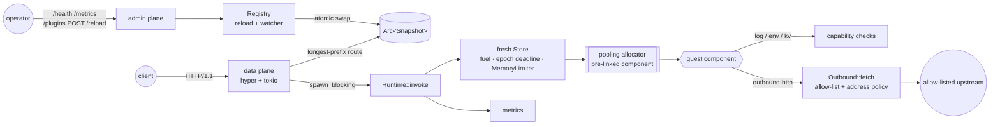

# plugbox

A sandboxed plugin runtime for edge request handlers, built on
[wasmtime](https://wasmtime.dev) and the WebAssembly component model.

Operators mount untrusted WebAssembly components on HTTP routes. Each
request runs in a fresh instance under three independent limits (fuel, a
wall-clock epoch deadline, a memory budget). The plugin can use only the
capabilities the operator granted it in `plugbox.toml`: specific env vars,
an outbound HTTP allow-list, a KV namespace. Plugins can be hot-reloaded
without dropping traffic. The host exposes Prometheus metrics for every
trap, denial and reload.

```
$ make demo
...
3. resource limits (instance discarded, host unaffected)
  GET  /hostile/loop      -> 504 [fuel-exhausted]      3.93 ms  plugin error: fuel-exhausted
  GET  /nofuel/loop       -> 504 [deadline-exceeded]  65.40 ms  plugin error: deadline-exceeded
  GET  /hostile/bomb      -> 502 [memory-limit]        2.13 ms  plugin error: memory-limit
  GET  /hello?name=still-healthy -> 200                0.33 ms  hello from the edge, still-healthy!
```

## Who it is for

* Engineers who want to see how an edge platform runs third-party request
  handlers safely, at a size you can read in one sitting: about 4,700 lines
  of host Rust.
* Anyone evaluating wasmtime's sandboxing knobs (fuel, epochs, pooling,
  `ResourceLimiter`, import policies) and wanting tested examples of each.
* Security reviewers. The [security model](docs/THREAT_MODEL.md) lists
  every control and the test that proves it.

This is a portfolio and reference project. It has not run in production,
and some features a real edge platform needs are missing (TLS egress,
streaming bodies, persistent KV); see [Limitations](#limitations).

## Features

| area | what plugbox does |
|---|---|
| Host interface | WIT package `plugbox:host@0.1.0` ([wit/plugbox.wit](wit/plugbox.wit)): `handler` export; `log`, `env`, `outbound-http`, `kv` imports |
| Isolation | one instance per request; locked-down WASI (no args, no env, no preopens, no sockets, captured stdio); load-time import policy that refuses `wasi:sockets` / `wasi:http` |
| CPU limits | fuel (deterministic) **and** epoch interruption (wall clock) on every request |
| Memory limits | one budget across all memories of a component; pool-level `max_memory_size`; native stack cap |
| Capabilities | deny-by-default grants per plugin; ungranted calls return typed errors and are counted, never trap |
| Outbound HTTP | strict URL parser, allow rules, post-DNS address policy (metadata and link-local always refused), no re-resolution, per-request call budget, timeouts capped by the remaining deadline |
| KV | namespaced, quota-enforced, read-only grants; private implicit namespaces |
| Pooling | wasmtime pooling allocator, pre-linked `InstancePre`, optional AOT cache; pool exhaustion sheds with 503 |
| Hot reload | atomic snapshots; all-or-nothing; unchanged components are not recompiled; file watcher + `POST /reload` |
| Metrics | Prometheus text on the admin plane: requests, latency, instantiate time, fuel, traps by kind, denials, outbound results, shedding, reloads, pool occupancy |
| Sample plugins | Rust → `wasm32-wasip2`: `hello` (env), `counter` (KV), `fetcher` (outbound HTTP), `hostile` (every limit), `sneaky` (raw socket, rejected at load) |

## Architecture



Per request: route on an immutable snapshot, buffer the body under a limit,
take a concurrency permit (or shed with 503), then on a blocking thread
create a `Store` with its own limiter, fuel and epoch deadline, instantiate
the pre-linked component into a pool slot, call `handle`, classify the
outcome, validate the response, record metrics and drop the store. Details,
algorithms and complexity are in [docs/ARCHITECTURE.md](docs/ARCHITECTURE.md).

## Quickstart

Requirements: Rust 1.97+ with the `wasm32-wasip2` target, and
`cargo-llvm-cov` for the coverage gate.

```sh
rustup target add wasm32-wasip2
cargo install cargo-llvm-cov            # only for `make check`

make plugins                            # build sample plugins → plugins/dist/*.wasm
make demo                               # offline end-to-end demo (below)
make check                              # fmt + clippy (host and guests) + tests under coverage ≥ 80%
make bench                              # cold vs pooled benchmark → docs/bench-results.json
```

Run a server with the example config (paths are relative to the file):

```sh
cargo run --release -- serve --config examples/plugbox.toml
curl 'http://127.0.0.1:8080/hello?name=you'        # hello from the edge, you!
curl -X POST http://127.0.0.1:8080/count/hit/home  # {"name":"home","count":1}
curl http://127.0.0.1:9901/metrics                 # admin plane (loopback)
```

Other CLI commands:

```sh
plugbox check   --config plugbox.toml   # validate config, compile every plugin, exit
plugbox run     --config plugbox.toml --plugin hello --query name=cli
plugbox inspect plugins/dist/sneaky.wasm  # imports/exports + policy verdict (exit 2 if rejected)
plugbox bench   --component plugins/dist/hello.wasm --iterations 2000 --threads 4
```

`plugbox run` prints the response and the per-request stats, for example
(real output):

```
status: 200
content-type: text/plain; charset=utf-8

hello from the edge, cli!

-- 1.16 ms total, 0.70 ms instantiate, fuel 8306, peak memory 1088 KiB, outbound 0, denials 0
```

Logging is controlled by `PLUGBOX_LOG` (an `EnvFilter`, default `info`); see
`.env.example`.

### Configuration

```toml
[[plugins]]
name = "fetcher"
route = "/api"
component = "../plugins/dist/fetcher.wasm"
limits = { fuel = 50_000_000, timeout_ms = 1000, memory = "32MiB" }
[plugins.grants.env]
vars = { UPSTREAM = "http://127.0.0.1:18081/v1" }
[plugins.grants.http]
allow = ["http://127.0.0.1:18081/v1/*"]   # nothing else is reachable
max_requests = 2                           # outbound calls per inbound request
timeout_ms = 500
```

Omit a `grants.*` table to deny that capability. The fully annotated example
is [examples/plugbox.toml](examples/plugbox.toml).

### Writing a plugin

```rust
use plugbox_sdk::{Guest, Request, Response, env, query_param, text};

struct Hello;

impl Guest for Hello {
    fn handle(req: Request) -> Response {
        let greeting = env::get("GREETING").unwrap_or_else(|| "hello".into());
        let name = query_param(&req.query, "name").unwrap_or_else(|| "world".into());
        text(200, format!("{greeting}, {name}!\n"))
    }
}

plugbox_sdk::export!(Hello with_types_in plugbox_sdk::bindings);
```

This is a trimmed version of [plugins/hello](plugins/hello/src/lib.rs). Build
with `cargo build --release --target wasm32-wasip2`; the output is already a
component.

## Demo

`make demo` (source: [examples/demo.rs](examples/demo.rs)) starts a real
server on ephemeral loopback ports next to a fixture upstream it also
starts, drives it over HTTP, hot-reloads it twice (once with a broken
component) and prints the admin plane. Nothing leaves the machine. Output
of a real run, also saved in [docs/demo-output.txt](docs/demo-output.txt):

```
== plugbox demo ==
loaded 5 plugins in 100 ms (pooling allocator, epoch tick 5 ms); fixture upstream on 127.0.0.1:60306
  hostile         /hostile  e7236a80e20b  grants: none
  hostile-nofuel  /nofuel   e7236a80e20b  grants: none
  counter         /count    fd629b9dc4d9  grants: kv[counter rw]
  hello           /hello    3f4f4beec230  grants: env[GREETING]
  fetcher         /api      ecd4f106f749  grants: env[UPSTREAM] http[8 calls/req]
data plane http://127.0.0.1:60307  admin plane http://127.0.0.1:60308

1. well-behaved plugins
  GET  /hello?name=edge                             -> 200                        0.92 ms  hello from the edge, edge!
       └ env grant: GREETING
  POST /count/hit/home                              -> 200                        0.35 ms  {"name":"home","count":1}
  POST /count/hit/home                              -> 200                        0.24 ms  {"name":"home","count":2}
  POST /count/hit/home                              -> 200                        0.23 ms  {"name":"home","count":3}
       └ KV state outlives each per-request instance
  GET  /api/proxy/items/42                          -> 200                        0.50 ms  {"item":42,"served_by":"fixture-upstream","target":"/v1/items/42"}
       └ outbound HTTP via the allow-list

2. capability denials (typed errors, no trap)
  GET  /api/fetch?url=http://169.254.169.254/latest/meta-data/ -> 403                        0.24 ms  forbidden by allow-list: http://169.254.169.254/latest/meta-data/ matches no allow rule
       └ cloud metadata: not on the allow-list
  GET  /api/fetch?url=http://127.0.0.1@169.254.169.254/ -> 400                        0.21 ms  invalid url: userinfo, backslashes and percent-escapes are not allowed in the host
       └ userinfo confusion rejected by the URL parser
  GET  /hostile/secret                              -> 200                        0.37 ms  {"granted_secret":false,"wasi_env":[],"etc_passwd":"Err(Os { code: 44, kind: NotFound, mes…
       └ no env, no host env, no filesystem
  GET  /hostile/kv                                  -> 403                        0.23 ms  kv refused: KvError::NotGranted
       └ no KV grant

3. resource limits (instance discarded, host unaffected)
  GET  /hostile/loop                                -> 504 [fuel-exhausted]       3.93 ms  plugin error: fuel-exhausted
       └ infinite loop, 50M fuel budget
  GET  /nofuel/loop                                 -> 504 [deadline-exceeded]   65.40 ms  plugin error: deadline-exceeded
       └ infinite loop, fuel off, 40 ms epoch deadline
  GET  /hostile/bomb                                -> 502 [memory-limit]         2.13 ms  plugin error: memory-limit
       └ allocates until the 16 MiB budget refuses
  GET  /hostile/recurse                             -> 502 [stack-overflow]       0.51 ms  plugin error: stack-overflow
       └ native wasm stack exhausted
  GET  /hostile/panic                               -> 502 [guest-abort]          0.37 ms  plugin error: guest-abort
       └ Rust panic = guest abort
  GET  /hostile/huge-response?bytes=4000000         -> 502 [invalid-response]     1.01 ms  plugin error: invalid-response
       └ 4 MB body > 1 MiB response limit
  GET  /hello?name=still-healthy                    -> 200                        0.33 ms  hello from the edge, still-healthy!
       └ host still serving

4. hot reload
  POST /reload -> 200 { "added": [], "generation": 2, "rebound": [ "hello" ], "removed": [], "unchanged": [ "counter", "fetcher", "hostile", "hostile-nofuel" ], "updated": [], "warnings": [] }
  GET  /hello?name=edge                             -> 200                        0.28 ms  bonjour, edge!
       └ new grant, same compiled component
  POST /reload (broken component) -> 422 active_generation=2 error="plugin `hello`: expected `(`"
  GET  /hello?name=edge                             -> 200                        0.27 ms  bonjour, edge!
       └ old snapshot keeps serving

5. admin plane
  GET /health -> status="ok" generation=2 plugins=5 in_flight=0 pool_live_instances=0
    last_reload_error: plugin `hello`: expected `(`
  GET /metrics (selected series):
    plugbox_traps_total{plugin="hostile",kind="fuel-exhausted"} 1
    plugbox_traps_total{plugin="hostile",kind="guest-abort"} 1
    plugbox_traps_total{plugin="hostile",kind="invalid-response"} 1
    plugbox_traps_total{plugin="hostile",kind="memory-limit"} 1
    plugbox_traps_total{plugin="hostile",kind="stack-overflow"} 1
    plugbox_traps_total{plugin="hostile-nofuel",kind="deadline-exceeded"} 1
    plugbox_capability_denials_total{plugin="fetcher",capability="http"} 1
    plugbox_capability_denials_total{plugin="hostile",capability="env"} 1
    plugbox_capability_denials_total{plugin="hostile",capability="kv"} 1
    plugbox_outbound_requests_total{plugin="fetcher",result="forbidden"} 1
    plugbox_outbound_requests_total{plugin="fetcher",result="invalid_url"} 1
    plugbox_outbound_requests_total{plugin="fetcher",result="ok"} 1
    plugbox_reloads_total{result="error"} 1
    plugbox_reloads_total{result="ok"} 1
    plugbox_pool_live_instances 0

demo complete
```

The deadline-exceeded request takes about 65 ms against a 40 ms budget.
That is the epoch tick (5 ms), the extra safety tick, and scheduling delay
on a machine whose load average was around 9 at the time. The memory bomb
fails in about 2 ms because the limiter refuses the growth immediately.

## Tests

`make check` runs, in order: `cargo fmt --check` (host and guests),
`cargo clippy -D warnings` (host with all targets, guests for
`wasm32-wasip2`), the guest build, and every test under `cargo llvm-cov`
with a line-coverage gate of 80%.

| suite | what it proves |
|---|---|
| `tests/limits.rs` (14) | infinite loop trips fuel; trips the epoch deadline with fuel off; memory bomb trips the memory limit; native and shadow stack overflows are contained; panics are contained; forbidden host (metadata address) is refused without a trap; ungranted env/files/KV are invisible; outbound call budget; log/stdout floods are capped; oversized responses are replaced; the host stays healthy under concurrent abuse and after 100 sequential traps with no leaked pool slots |
| `tests/capabilities.rs` (6) | exact env grants; request fields round-trip; KV persists across fresh instances, read-only and no-grant variants of the same binary; KV quotas surface as guest errors; outbound reaches only allow-listed upstreams, DNS-to-loopback refused unless `allow_private`; unreachable upstream is a typed transport error |
| `tests/policy.rs` (4) | the raw-socket plugin is rejected at load; a registry will not start with it; all sample plugins pass; a component without the handler export is rejected |
| `tests/reload.rs` (7) | grant change rebinds without recompiling; component swap updates and KV survives; failed reload keeps serving the old snapshot; restart-only settings warn; add/remove plugins; in-flight requests finish on the old version; the file watcher reloads |
| `tests/pooling.rs` (4) | pool exhaustion sheds instead of blocking; instances never share state between requests; on-demand strategy behaves the same; AOT cache is written and reused |
| `tests/server.rs` (5) | routing over real HTTP; traps map to 502/504 with `x-plugbox-error`; oversized bodies get 413 before the sandbox; excess concurrency is shed; the admin plane |
| `tests/bench.rs` (2) | every benchmark mode produces consistent numbers; failing requests fail the benchmark |
| unit tests (61, incl. 4 property tests) | URL parser and allow rules (proptest: never panics, round-trips, userinfo always rejected, no look-alike wildcard matches), address policy, HTTP response parser (proptest: never panics, chunked round-trip), KV against a model (proptest), config validation, memory limiter, metrics rendering, trap classification, response validation |

Result of `make check` from a fresh clone (see the report for the full
log): **103 tests passed, 0 failed; line coverage 96.8%** (`cargo llvm-cov
--lib --tests --ignore-filename-regex 'src/main\.rs'`, the command `make
coverage` runs).

## Benchmark: cold vs pooled

`make bench` runs `plugbox bench --component plugins/dist/hello.wasm
--iterations 2000 --threads 4 --json docs/bench-results.json`
([src/bench.rs](src/bench.rs)). Every mode measures the whole request path
(store, limits, instantiation, `handle` call, teardown) for the `hello`
plugin. The modes differ only in what is already prepared when the request
arrives:

| mode | per-request work |
|---|---|
| `cold-jit` | compile the component with cranelift, check the import policy, link, instantiate, call |
| `cold-aot` | deserialize a precompiled artifact, link, instantiate, call |
| `warm-ondemand` | instantiate a pre-linked component with fresh `mmap`s, call |
| `warm-pooled` | instantiate a pre-linked component into a pooling-allocator slot, call |

Latency is single-threaded; throughput uses 4 threads. Cold modes run
`iterations / 20` samples. Measured on an Apple M1 Pro (macOS, arm64),
release build, while other builds shared the machine (load average
about 9.9 on 8 cores):

| mode | samples | p50 µs | p90 µs | p99 µs | mean µs | instantiate p50 µs | throughput (req/s) |
|---|---:|---:|---:|---:|---:|---:|---:|
| cold-jit | 100 | 26269.3 | 42994.5 | 66129.7 | 30033.4 | — | 32 (4 threads) |
| cold-aot | 100 | 444.8 | 497.6 | 636.6 | 467.8 | — | 1665 (4 threads) |
| warm-ondemand | 2000 | 23.8 | 27.4 | 40.4 | 24.9 | 11.0 | 75790 (4 threads) |
| warm-pooled | 2000 | 32.8 | 37.8 | 64.2 | 34.0 | 13.5 | 41205 (4 threads) |

What this shows:

* **Pre-compiling and pre-linking matter most.** A JIT cold start costs
  about 26 ms at p50, an AOT cold start about 0.44 ms, and a warm
  instantiate-and-call about 24–33 µs. That is roughly three orders of
  magnitude between JIT cold and warm.
* **On this platform the pooling allocator was slower than on-demand
  allocation** (p50 32.8 vs 23.8 µs; throughput 41k vs 76k req/s). We
  report this as measured. In wasmtime 50 the cheap slot-reset paths are
  Linux-only (`madvise` decommit, `linear_memory_keep_resident`); on macOS
  a slot is reset by re-`mmap`ing it. We have not measured on Linux, so we
  make no Linux claim. The pool is the default anyway because it gives
  pre-reserved, bounded memory and hard admission control: pool exhaustion
  sheds with a 503 instead of consuming more address space (see
  `pooling::exhausted_pool_sheds_instead_of_blocking`). `instance_strategy
  = "on-demand"` is one config line away.
* Numbers on a loaded laptop are noisy. Rerun `make bench` on your own
  hardware before drawing conclusions.

## Design decisions

The full list, with the cost of each ruling, is in
[DECISIONS.md](DECISIONS.md). The ones that shape the system:

1. **Fresh instance per request.** No state survives in linear memory, so
   there is no cross-request leak and a trapped instance is never re-entered.
   State that must persist goes through KV.
2. **Fuel and epochs, both always on.** Fuel is deterministic, and the
   tests depend on that. Epochs bound wall-clock time.
3. **Deny without trapping.** Every capability interface is always linked.
   Ungranted calls return typed errors, so one binary can run under
   different grants. Traps are reserved for resource limits.
4. **Refuse at load, not at request.** The import policy rejects
   `wasi:sockets` and friends before any code runs.
5. **Reject URL tricks instead of normalising them, and resolve DNS once.**
   This avoids the checker/client mismatch behind most SSRF allow-list
   bypasses.
6. **All-or-nothing reloads on immutable snapshots.** Requests in flight
   finish on the version they started with.
7. **Guest code never runs on an async worker.** It runs on
   `spawn_blocking` behind a non-blocking semaphore, and overload is shed.

## Security model

Summary: plugin code, HTTP clients and upstream responses are untrusted.
The operator, the config file, the component files, the AOT cache
directory and the admin listener are trusted. The full threat model, with
the test behind each control and what is *not* mitigated (Spectre-class
side channels, wasmtime bugs, plaintext egress), is in
[docs/THREAT_MODEL.md](docs/THREAT_MODEL.md).

## Limitations

* **No TLS for outbound HTTP.** `https://` allow rules parse, but the
  built-in client only speaks plain HTTP/1.1, so HTTPS calls fail with a
  transport error. The `Upstream` trait is where a TLS client would go.
* **Fully buffered bodies.** Requests and responses are `list<u8>`. There
  is no streaming, no WebSockets, no server-sent events, and
  `max_request_body` / `max_response_body` bound what a plugin can handle.
* **KV is in-memory and process-local.** One global mutex, no persistence,
  no replication. Data is lost on restart.
* **HTTP/1.1 only** on the data plane (hyper's `http1` server). No HTTP/2,
  no TLS termination; put plugbox behind a proxy for those.
* **Admin plane has no authentication.** It defaults to loopback and must
  stay on a trusted network.
* **Sync execution model.** Each concurrent invocation holds an OS thread
  from tokio's blocking pool, and host calls (outbound HTTP) block that
  thread. Very high concurrency would want wasmtime's async API.
* **Side channels are out of scope.** Mutually hostile tenants share one
  process. plugbox does nothing beyond wasmtime's defaults against
  Spectre-class attacks.
* **Polling file watcher.** Reload latency is up to two poll intervals.
  A rewrite that keeps the same size within one mtime tick could be
  missed; `POST /reload` is the reliable trigger.
* **Benchmarks come from one loaded macOS laptop.** There are no Linux
  numbers, and the pooled-vs-on-demand result may well be reversed on Linux.
* **Guests must be components.** Only Rust guests (`wasm32-wasip2`) were
  built and tested. Other languages should work through any component
  toolchain, but this is untested.
* **CI has never run.** `.github/workflows/ci.yml` runs the same `make
  check`, demo and a short benchmark, but the repository has not been
  pushed, so the workflow has not executed.

## Roadmap

1. A TLS outbound client (rustls) behind the existing `Upstream` trait,
   with SNI pinned to the allow-listed host.
2. Streaming bodies via `wasi:io` streams in the WIT interface.
3. A pluggable KV backend (sharded in-process, then an external store)
   behind the same interface.
4. Linux benchmark runs with `linear_memory_keep_resident` and
   memory-protection keys.
5. Wasmtime's async API, so that host calls yield instead of blocking
   threads.
6. Admin-plane authentication (mTLS or bearer token) and per-client rate
   limiting on the data plane.

## Repository layout

```
src/            host runtime (library + CLI)
wit/            plugbox:host WIT package
plugins/        guest workspace: sdk + sample plugins (wasm32-wasip2)
tests/          integration tests (need `make plugins`)
examples/       demo.rs (make demo) and an annotated plugbox.toml
docs/           ARCHITECTURE.md, THREAT_MODEL.md, demo output, bench results
```

## License

MIT. See [LICENSE](LICENSE).
