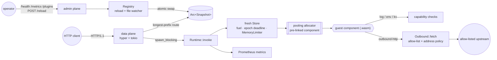

# plugbox

A sandboxed plugin runtime for edge request handlers: untrusted WebAssembly
components mounted on HTTP routes, each request in a fresh
[wasmtime](https://wasmtime.dev) instance under fuel, wall-clock and memory
limits, with deny-by-default capability grants.

[](https://github.com/SlateGitOrg/plugbox/actions/workflows/ci.yml)

## Why

An edge platform that runs customer code on every request is running
untrusted code next to everyone else's traffic. That code can loop forever,
allocate until the node swaps, sleep while holding a worker, read the host's
environment, or use the node as an SSRF proxy into cloud metadata. plugbox
turns each of those into a bounded, observable failure of the one request
that caused it: the guest gets a typed error or its instance is discarded,
the client gets a 4xx/5xx, the operator gets a metric, and the host keeps
serving. The host is about 5,000 lines of Rust (excluding tests), and every
control in the [threat model](docs/THREAT_MODEL.md) names the test that
proves it.

## Features

- **WIT host interface.** Package `plugbox:host@0.1.0`
  ([wit/plugbox.wit](wit/plugbox.wit)): plugins export `handler` and may
  import `log`, `env`, `outbound-http` and `kv`.
- **One instance per request.** Locked-down WASI (no args, no env, no
  preopens, no sockets, captured stdio); nothing in linear memory survives
  a request.
- **Load-time import policy.** Components importing `wasi:sockets` or
  `wasi:http` are refused before any code runs (`plugbox inspect` shows the
  verdict).
- **CPU limits.** Fuel (deterministic) *and* epoch interruption (wall
  clock) on every request; WASI clock waits such as `thread::sleep` are
  capped at the request deadline.
- **Memory limits.** One budget across all memories of a component, a
  pool-wide `max_memory_size`, and a native stack cap.
- **Capability grants.** Deny by default, per plugin. Ungranted calls
  return typed errors and are counted; they never trap.
- **SSRF-resistant outbound HTTP.** Strict URL parser, allow rules,
  post-DNS address policy (metadata and link-local always refused), no
  re-resolution, a per-request call budget, timeouts capped by the remaining
  deadline.
- **KV store.** Namespaced, quota-enforced, optionally read-only; a
  plugin's implicit namespace is private.
- **Pooling and AOT.** Wasmtime pooling allocator, pre-linked
  `InstancePre`, optional ahead-of-time artifact cache; pool exhaustion
  sheds with 503 instead of blocking.
- **Hot reload.** Atomic snapshots, all-or-nothing, unchanged components
  are not recompiled; a polling file watcher plus `POST /reload`.
- **Prometheus metrics** on a separate admin listener: requests, latency,
  instantiate time, fuel, traps by kind, denials, outbound results,
  shedding, reloads, pool occupancy.
- **Sample plugins** (Rust → `wasm32-wasip2`): `hello` (env), `counter`
  (KV), `fetcher` (outbound HTTP), `hostile` (trips every limit), `sneaky`
  (raw socket, rejected at load).

## Architecture



Per request: route on an immutable snapshot, buffer the body under a limit,
take a concurrency permit (or shed with 503), then on a blocking thread
create a `Store` with its own limiter, fuel and epoch deadline, instantiate
the pre-linked component into a pool slot, call `handle`, classify the
outcome, validate the response, record metrics and drop the store. The
module map, request sequence, limits and reload algorithm are in
[docs/ARCHITECTURE.md](docs/ARCHITECTURE.md).

## Quick start

Prerequisites:

- Rust 1.97 or newer (edition 2024) with the `wasm32-wasip2` target
- `rustfmt`, `clippy` and [`cargo-llvm-cov`](https://github.com/taiki-e/cargo-llvm-cov)
  (0.9.x) only for the full `make check` gate

```sh
rustup target add wasm32-wasip2

make plugins      # build the sample plugins → plugins/dist/*.wasm
make demo         # offline end-to-end demo (see below)
make test         # all 109 tests
```

Everything runs offline on macOS or Linux; no Docker, root or network
access is needed. The full gate that CI runs:

```sh
rustup component add rustfmt clippy llvm-tools-preview
cargo install cargo-llvm-cov --version 0.9.1 --locked
make check        # fmt + clippy (host and guests) + tests under coverage ≥ 80%
```

Serve the example config (paths in it are relative to the file):

```sh
cargo run --release -- serve --config examples/plugbox.toml
```

In another terminal:

```sh
curl 'http://127.0.0.1:8080/hello?name=you'          # hello from the edge, you!
curl -X POST http://127.0.0.1:8080/count/hit/home    # {"name":"home","count":1}
curl -s http://127.0.0.1:9901/metrics | head         # admin plane (loopback only)
```

## Usage

The binary is `target/release/plugbox` (or `cargo run --release -- <command>`):

```text
plugbox serve   --config plugbox.toml                 # data + admin listeners
plugbox check   --config plugbox.toml                 # validate config, compile every plugin, exit
plugbox run     --config plugbox.toml --plugin hello --query name=cli
plugbox inspect plugins/dist/sneaky.wasm              # imports/exports + policy verdict (exit 2 if rejected)
plugbox bench   --component plugins/dist/hello.wasm --iterations 2000 --threads 4
```

`plugbox run` invokes one plugin without a server and prints the response
and the per-request stats:

```text
$ PLUGBOX_LOG=warn cargo run --release -q -- run --config examples/plugbox.toml --plugin hello --query name=cli
status: 200
content-type: text/plain; charset=utf-8

hello from the edge, cli!

-- 0.14 ms total, 0.08 ms instantiate, fuel 8306, peak memory 1088 KiB, outbound 0, denials 0
```

`plugbox inspect` shows why a component is refused before it ever runs:

```text
$ cargo run --release -q -- inspect plugins/dist/sneaky.wasm
component: plugins/dist/sneaky.wasm (123040 bytes)
imports:
  plugbox:host/types@0.1.0
  wasi:io/poll@0.2.9
  ...
  wasi:sockets/tcp@0.2.9
  wasi:sockets/tcp-create-socket@0.2.9
  wasi:sockets/ip-name-lookup@0.2.9
exports:
  plugbox:host/handler@0.1.0
policy: REJECTED
  - import `wasi:sockets/network@0.2.9` is not provided by the plugbox sandbox
  ...
  - import `wasi:sockets/ip-name-lookup@0.2.9` is not provided by the plugbox sandbox
$ echo $?
2
```

Host logging is controlled by `PLUGBOX_LOG` (a tracing `EnvFilter`,
default `info`); see [.env.example](.env.example).

### Configuration

```toml
[[plugins]]
name = "fetcher"
route = "/api"
component = "../plugins/dist/fetcher.wasm"
limits = { fuel = 50_000_000, timeout_ms = 1000, memory = "32MiB" }
[plugins.grants.env]
vars = { UPSTREAM = "http://127.0.0.1:18081/v1" }
[plugins.grants.http]
allow = ["http://127.0.0.1:18081/v1/*"]   # nothing else is reachable
max_requests = 2                           # outbound calls per inbound request
timeout_ms = 500
```

Omit a `grants.*` table to deny that capability. Every setting is annotated
in [examples/plugbox.toml](examples/plugbox.toml).

### Writing a plugin

```rust
use plugbox_sdk::{Guest, Request, Response, env, query_param, text};

struct Hello;

impl Guest for Hello {
    fn handle(req: Request) -> Response {
        let greeting = env::get("GREETING").unwrap_or_else(|| "hello".into());
        let name = query_param(&req.query, "name").unwrap_or_else(|| "world".into());
        text(200, format!("{greeting}, {name}!\n"))
    }
}

plugbox_sdk::export!(Hello with_types_in plugbox_sdk::bindings);
```

A trimmed version of [plugins/hello](plugins/hello/src/lib.rs). Build it
with `cargo build --release --target wasm32-wasip2`; the output is already
a component.

### Demo

`make demo` ([examples/demo.rs](examples/demo.rs)) starts a real server on
ephemeral loopback ports next to a fixture upstream it also starts, drives
it over HTTP, hot-reloads it twice (once with a broken component) and
prints the admin plane. Nothing leaves the machine. Trimmed output of a
real run (full output in [docs/demo-output.txt](docs/demo-output.txt)):

```text
== plugbox demo ==
loaded 5 plugins in 79 ms (pooling allocator, epoch tick 5 ms); fixture upstream on 127.0.0.1:60417

1. well-behaved plugins
  GET  /hello?name=edge                             -> 200                        0.88 ms  hello from the edge, edge!
       └ env grant: GREETING
  POST /count/hit/home                              -> 200                        0.53 ms  {"name":"home","count":1}
  POST /count/hit/home                              -> 200                        0.32 ms  {"name":"home","count":2}
  POST /count/hit/home                              -> 200                        0.34 ms  {"name":"home","count":3}
       └ KV state outlives each per-request instance
  GET  /api/proxy/items/42                          -> 200                        0.64 ms  {"item":42,"served_by":"fixture-upstream","target":"/v1/items/42"}
       └ outbound HTTP via the allow-list

2. capability denials (typed errors, no trap)
  GET  /api/fetch?url=http://169.254.169.254/latest/meta-data/ -> 403                        0.29 ms  forbidden by allow-list: http://169.254.169.254/latest/meta-data/ matches no allow rule
       └ cloud metadata: not on the allow-list
  GET  /api/fetch?url=http://127.0.0.1@169.254.169.254/ -> 400                        0.28 ms  invalid url: userinfo, backslashes and percent-escapes are not allowed in the host
       └ userinfo confusion rejected by the URL parser
  GET  /hostile/secret                              -> 200                        0.52 ms  {"granted_secret":false,"wasi_env":[],"etc_passwd":"Err(Os { code: 44, kind: NotFound, mes…
       └ no env, no host env, no filesystem
  GET  /hostile/kv                                  -> 403                        0.28 ms  kv refused: KvError::NotGranted
       └ no KV grant

3. resource limits (instance discarded, host unaffected)
  GET  /hostile/loop                                -> 504 [fuel-exhausted]       4.72 ms  plugin error: fuel-exhausted
       └ infinite loop, 50M fuel budget
  GET  /nofuel/loop                                 -> 504 [deadline-exceeded]   51.95 ms  plugin error: deadline-exceeded
       └ infinite loop, fuel off, 40 ms epoch deadline
  GET  /nofuel/sleep                                -> 504 [deadline-exceeded]   41.63 ms  plugin error: deadline-exceeded
       └ 1 h thread::sleep in wasi:io/poll, cut at the 40 ms deadline
  GET  /hostile/bomb                                -> 502 [memory-limit]         3.03 ms  plugin error: memory-limit
       └ allocates until the 16 MiB budget refuses
  GET  /hostile/recurse                             -> 502 [stack-overflow]       0.51 ms  plugin error: stack-overflow
       └ native wasm stack exhausted
  GET  /hostile/panic                               -> 502 [guest-abort]          0.48 ms  plugin error: guest-abort
       └ Rust panic = guest abort
  GET  /hostile/huge-response?bytes=4000000         -> 502 [invalid-response]     0.96 ms  plugin error: invalid-response
       └ 4 MB body > 1 MiB response limit
  GET  /hello?name=still-healthy                    -> 200                        0.22 ms  hello from the edge, still-healthy!
       └ host still serving

4. hot reload
  POST /reload -> 200 { "added": [], "generation": 2, "rebound": [ "hello" ], "removed": [], "unchanged": [ "counter", "fetcher", "hostile", "hostile-nofuel" ], "updated": [], "warnings": [] }
  GET  /hello?name=edge                             -> 200                        0.30 ms  bonjour, edge!
       └ new grant, same compiled component
  POST /reload (broken component) -> 422 active_generation=2 error="plugin `hello`: expected `(`"
  GET  /hello?name=edge                             -> 200                        0.24 ms  bonjour, edge!
       └ old snapshot keeps serving

5. admin plane
  GET /health -> status="ok" generation=2 plugins=5 in_flight=0 pool_live_instances=0
    last_reload_error: plugin `hello`: expected `(`
  GET /metrics (selected series):
    plugbox_traps_total{plugin="hostile",kind="fuel-exhausted"} 1
    plugbox_traps_total{plugin="hostile-nofuel",kind="deadline-exceeded"} 2
    plugbox_capability_denials_total{plugin="hostile",capability="kv"} 1
    plugbox_reloads_total{result="error"} 1
    ...

demo complete
```

`/nofuel/loop` overshoots its 40 ms budget because the epoch deadline is
`ceil(40 / 5) + 1 = 9` ticks (up to 45 ms), plus however long the ticker
thread takes to be scheduled on a busy machine. The one-hour
`thread::sleep` ends at about 42 ms: the guest runs no wasm while it waits,
so the deadline-capped clock, not the epoch tick, releases it. The memory
bomb fails in about 3 ms because the limiter refuses the growth at once.

## How it works

The full list of rulings, each with its cost, is in
[DECISIONS.md](DECISIONS.md). The ones that shape the system:

1. **Fresh instance per request.** No state survives in linear memory, so
   there is no cross-request leak and a trapped instance is never
   re-entered. State that must persist goes through KV.
2. **Fuel and epochs, both always on, plus a deadline-capped clock.** Fuel
   is deterministic, and the tests depend on that. Epochs bound wall-clock
   time while wasm runs (deadline = `ceil(timeout / tick) + 1` ticks). The
   monotonic clock is replaced so a guest blocked in `wasi:io/poll` is also
   released at its deadline.
3. **Deny without trapping.** Every capability interface is always linked;
   ungranted calls return typed errors, so one binary runs under different
   grants. Traps are reserved for resource limits.
4. **Refuse at load, not at request.** The import policy rejects
   `wasi:sockets` and friends before any code runs.
5. **Reject URL tricks instead of normalising them, and resolve DNS once.**
   This avoids the checker/client mismatch behind most SSRF allow-list
   bypasses, and the client never re-resolves (no DNS-rebinding window).
6. **All-or-nothing reloads on immutable snapshots.** Requests in flight
   finish on the version they started with; a broken reload leaves the old
   snapshot serving.
7. **Guest code never runs on an async worker.** It runs on
   `spawn_blocking` behind a non-blocking semaphore, and overload is shed.
8. **Bounded address space.** Each linear memory reserves exactly
   `runtime.max_memory` plus a 64 KiB guard instead of wasmtime's 4 GiB
   default, so a 128-slot pool fits in a few GiB of virtual memory.

### Benchmark: cold vs pooled

`make bench` runs `plugbox bench` ([src/bench.rs](src/bench.rs)) against
the `hello` plugin. Every mode measures the whole request path (store,
limits, instantiation, `handle` call, teardown); they differ only in what
is prepared before the request arrives:

| mode | per-request work |
|---|---|
| `cold-jit` | compile with cranelift, check the import policy, link, instantiate, call |
| `cold-aot` | deserialize a precompiled artifact, link, instantiate, call |
| `warm-ondemand` | instantiate a pre-linked component with fresh `mmap`s, call |
| `warm-pooled` | instantiate a pre-linked component into a pooling-allocator slot, call |

Measured on an Apple M1 Pro (macOS, arm64), release build, while other
builds shared the machine (load average about 9.9 on 8 cores); latency is
single-threaded, throughput uses 4 threads, and cold modes run
`iterations / 20` samples. Raw data: [docs/bench-results.json](docs/bench-results.json).

| mode | samples | p50 µs | p90 µs | p99 µs | mean µs | instantiate p50 µs | throughput (req/s) |
|---|---:|---:|---:|---:|---:|---:|---:|
| cold-jit | 100 | 26269.3 | 42994.5 | 66129.7 | 30033.4 | — | 32 |
| cold-aot | 100 | 444.8 | 497.6 | 636.6 | 467.8 | — | 1665 |
| warm-ondemand | 2000 | 23.8 | 27.4 | 40.4 | 24.9 | 11.0 | 75790 |
| warm-pooled | 2000 | 32.8 | 37.8 | 64.2 | 34.0 | 13.5 | 41205 |

- **Pre-compiling and pre-linking matter most.** A JIT cold start costs
  about 26 ms at p50, an AOT cold start about 0.44 ms, and a warm
  instantiate-and-call 24–33 µs: roughly three orders of magnitude.
- **On macOS the pooling allocator was slower than on-demand allocation**
  (p50 32.8 vs 23.8 µs; 41k vs 76k req/s). In wasmtime 50 the cheap
  slot-reset paths (`madvise` decommit, `linear_memory_keep_resident`) are
  Linux-only; on macOS a slot is reset by re-`mmap`ing it. The pool is still
  the default because it gives pre-reserved, bounded memory and hard
  admission control (pool exhaustion sheds with 503). `instance_strategy =
  "on-demand"` is one config line away.
- Numbers from a loaded laptop are noisy; rerun `make bench` on your own
  hardware before drawing conclusions.

### Security model

Plugin code, HTTP clients and upstream responses are untrusted. The
operator, the config file, the component files, the AOT cache directory and
the admin listener are trusted. [docs/THREAT_MODEL.md](docs/THREAT_MODEL.md)
lists every control with the test behind it, and what is *not* mitigated
(Spectre-class side channels, wasmtime bugs, plaintext egress).

## Testing

```sh
make test         # build the plugins, then cargo test (109 tests)
make check        # what CI runs: fmt, clippy -D warnings, tests under cargo llvm-cov, 80% line gate
```

The integration tests load the real sample plugins, so they need
`make plugins` first (`make test` and `make check` do it).

| suite | what it proves |
|---|---|
| `tests/limits.rs` (17) | infinite loops trip fuel, and the epoch deadline with fuel off; a guest blocked in `thread::sleep` is cut at the deadline, alone and 16 at a time; memory bombs trip the memory limit; native and shadow stack overflows and panics are contained; the metadata address is refused without a trap; ungranted env/files/KV are invisible; outbound call budget; log/stdout floods are capped; oversized responses are replaced; the host stays healthy under concurrent abuse and after 100 sequential traps with no leaked pool slots |
| `tests/capabilities.rs` (6) | exact env grants; request fields round-trip; KV persists across fresh instances, with read-only and no-grant variants of the same binary; KV quotas surface as guest errors; outbound reaches only allow-listed upstreams, DNS-to-loopback refused unless `allow_private`; unreachable upstream is a typed transport error |
| `tests/policy.rs` (4) | the raw-socket plugin is rejected at load; a registry will not start with it; all sample plugins pass; a component without the handler export is rejected |
| `tests/reload.rs` (7) | grant changes rebind without recompiling; a component swap updates and KV survives; a failed reload keeps serving the old snapshot; restart-only settings warn; add/remove plugins; in-flight requests finish on the old version; the file watcher reloads |
| `tests/pooling.rs` (4) | pool exhaustion sheds instead of blocking; instances never share state; the on-demand strategy behaves the same; the AOT cache is written, reused, and a damaged entry is discarded and rebuilt |
| `tests/server.rs` (6) | routing over real HTTP; traps map to 502/504 with `x-plugbox-error`; oversized bodies get 413 before the sandbox; excess concurrency is shed; sleeping plugins release their permits at the deadline; the admin plane |
| `tests/bench.rs` (2) | every benchmark mode produces consistent numbers; failing requests fail the benchmark |
| unit tests (63, incl. 4 property tests) | URL parser and allow rules (proptest: never panics, round-trips, userinfo always rejected, no look-alike wildcard matches), address policy, HTTP response parser (proptest: never panics, chunked round-trip), KV against a model (proptest), config validation, memory limiter, deadline-capped clock waits, metrics rendering, trap classification, response validation |

Coverage is measured on the library with `cargo llvm-cov --lib --tests
--ignore-filename-regex 'src/main\.rs'` (the CLI entry point is thin glue
exercised by `make demo`); the last
measured result was 96.6% line coverage against the 80% gate.

## Project layout

```text
src/            host runtime (library + CLI)
  engine.rs     wasmtime engine: fuel, epochs, pooling, memory reservation
  runtime.rs    compile + AOT cache, import policy, pre-link, invoke, trap classification
  registry.rs   snapshots, all-or-nothing reload, file watcher
  server.rs     hyper data plane and admin plane
  outbound.rs   outbound HTTP enforcement + HTTP/1.1 client (allowlist.rs: URL rules)
  capability/   grant resolution and the KV store
wit/            plugbox:host WIT package
plugins/        guest workspace: sdk + sample plugins (wasm32-wasip2)
tests/          integration tests (need `make plugins`)
examples/       demo.rs (make demo) and an annotated plugbox.toml
docs/           architecture, threat model, demo output, benchmark results
```

## Limitations

- **No TLS for outbound HTTP.** `https://` allow rules parse, but the
  built-in client speaks plain HTTP/1.1 only, so HTTPS calls fail with a
  transport error. The `Upstream` trait is where a TLS client would go.
- **Fully buffered bodies.** Requests and responses are `list<u8>`: no
  streaming, WebSockets or server-sent events; `max_request_body` /
  `max_response_body` bound what a plugin can handle.
- **KV is in-memory and process-local.** One global mutex, no persistence,
  no replication; data is lost on restart.
- **HTTP/1.1 only** on the data plane, and no TLS termination; put plugbox
  behind a proxy for those.
- **The admin plane has no authentication.** It defaults to loopback and
  must stay on a trusted network.
- **Sync execution model.** Each concurrent invocation holds an OS thread
  from tokio's blocking pool, and host calls (outbound HTTP, clock waits)
  block that thread up to the request deadline, so keep `timeout_ms` short
  relative to `max_concurrency`. Blocked waits are bounded only because the
  clock is the sole blocking pollable plugbox links (threat model §3.2).
- **Side channels are out of scope.** Mutually hostile tenants share one
  process; plugbox adds nothing beyond wasmtime's defaults against
  Spectre-class attacks.
- **AOT cache files must not be edited in place.** Loaded artifacts stay
  memory-mapped; rewriting one under a running process breaks the plugins
  loaded from it (`SIGBUS` on Linux). Delete files to clear the cache.
- **Polling file watcher.** Reload latency is up to two poll intervals, and
  a same-size rewrite within one mtime tick can be missed; `POST /reload` is
  the reliable trigger.
- **Benchmarks are from one loaded macOS laptop.** There are no Linux
  numbers, and the pooled-vs-on-demand result may well reverse on Linux.
- **Only Rust guests were built and tested.** Other languages should work
  through any component toolchain, but this is untested.
- **Not production-proven.** plugbox has not served production traffic.

Next steps, in order: a rustls outbound client behind `Upstream` with SNI
pinned to the allow-listed host; streaming bodies via `wasi:io` streams; a
pluggable KV backend; Linux benchmarks with `linear_memory_keep_resident`
and memory-protection keys; wasmtime's async API so host calls yield
instead of blocking threads; admin-plane authentication.

## License

MIT — see [LICENSE](LICENSE).
