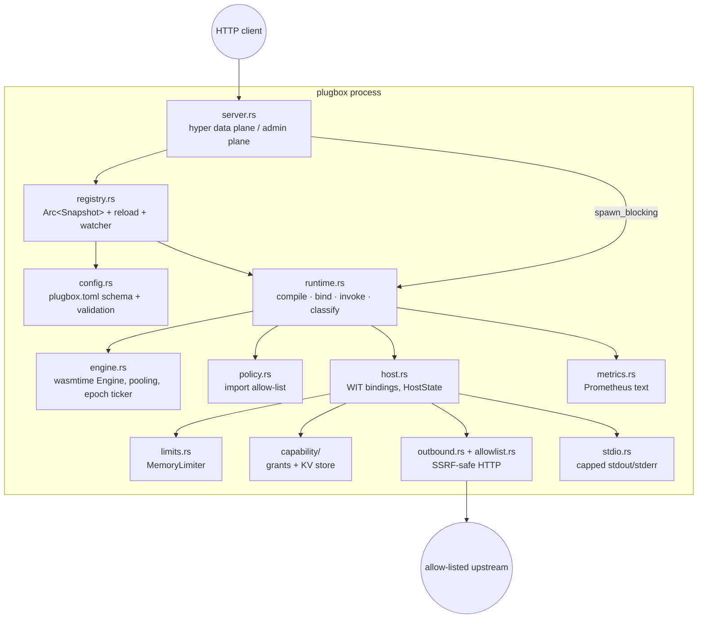
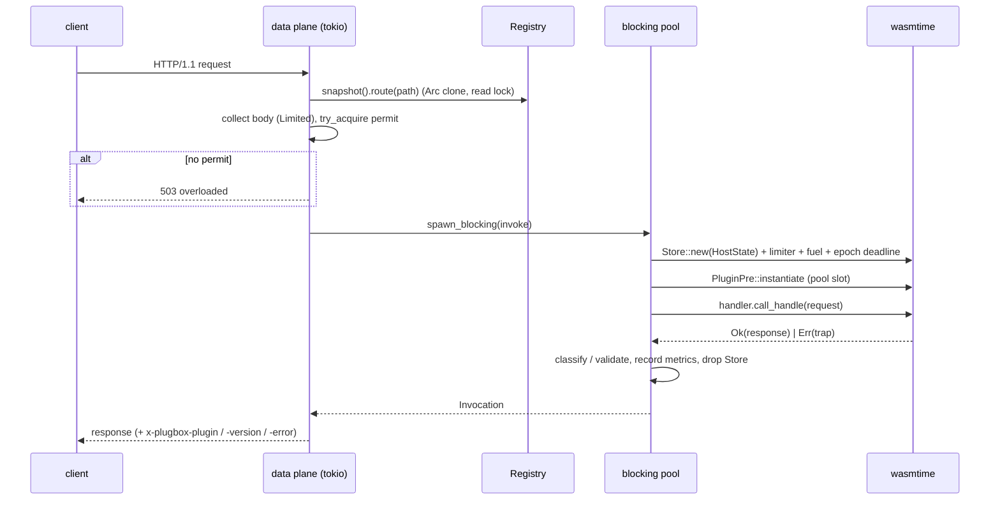

# plugbox architecture

This is the detailed design. The README has the overview; the security
argument is in [THREAT_MODEL.md](THREAT_MODEL.md).

## 1. Components



| module | lines (non-test) | responsibility |
|---|---:|---|
| `config.rs` | ~480 | TOML schema (`deny_unknown_fields`), `ByteSize`, semantic validation, route normalisation |
| `allowlist.rs` | ~470 | strict URL parser, allow rules, post-resolution address policy |
| `outbound.rs` | ~520 | the outbound enforcement pipeline, resolver/transport traits, HTTP/1.1 client and response parser |
| `capability/` | ~290 | resolving grants; the namespaced KV store with quotas |
| `engine.rs` | ~130 | engine config (fuel, epochs, pooling, memory reservation), epoch ticker thread |
| `limits.rs` | ~110 | `ResourceLimiter` that budgets all memories of a component together |
| `policy.rs` | ~80 | load-time import/export policy |
| `host.rs` | ~290 | `bindgen!` output, per-request `HostState`, host functions |
| `runtime.rs` | ~540 | AOT cache, compile + policy + pre-link, bind grants, invoke, trap classification, response validation, metrics |
| `registry.rs` | ~390 | immutable snapshots, all-or-nothing reload, change detection, polling watcher |
| `server.rs` | ~350 | data plane and admin plane on separate listeners |
| `metrics.rs` | ~355 | counter/gauge/histogram families, deterministic text rendering |
| `bench.rs` | ~285 | cold vs warm benchmark harness |
| `stdio.rs` | ~90 | capped stdout/stderr pipe that discards instead of erroring |
| `main.rs` | ~270 | CLI: `serve`, `check`, `run`, `inspect`, `bench` |

Line counts: `for f in src/*.rs src/capability/*.rs; do awk '/^#\[cfg\(test\)\]/{exit} {print}' $f | wc -l; done`.

## 2. The host interface (WIT)

`wit/plugbox.wit` defines package `plugbox:host@0.1.0` and one world:

```wit
world plugin {
    import log;            // always available, rate-limited
    import env;            // granted variables only
    import outbound-http;  // allow-listed fetch
    import kv;             // namespaced key-value
    export handler;        // handle: func(req: request) -> response
}
```

Every capability interface is *always linked*, even for plugins without the
grant. Ungranted calls return typed errors instead of failing to link.
Two reasons: one component binary can run under different grants (the tests
mount the same `counter.wasm` with read-write, read-only and no KV grants),
and a plugin can degrade gracefully instead of being unloadable.

Requests and responses are fully buffered `list<u8>` bodies. This keeps
the guest API to one synchronous function and makes response validation
possible before any byte reaches the client. The cost is that streaming is
impossible (see Limitations in the README).

Guests are built with `wit-bindgen 0.57.1` for `wasm32-wasip2`
(`plugins/sdk` wraps the bindings with small helpers). Rust's std for that
target imports `wasi:cli`, `wasi:io`, `wasi:clocks`, `wasi:random` and
`wasi:filesystem`, which is why the import policy allows those (inert)
interfaces.

## 3. Request lifecycle



Design points:

* **Guest code never runs on an async worker.** A plugin spinning until its
  deadline occupies one blocking-pool thread; the accept loop and other
  connections keep going. The blocking pool is sized `max_concurrency + 4`.
* **Admission before work.** The semaphore is `try_acquire`, not `acquire`:
  excess load is shed immediately rather than queued without bound. A second
  line of defence is the pool itself: if it has no free slot,
  `PoolConcurrencyLimitError` becomes `503 overloaded`.
* **The store is the unit of isolation.** `HostState` holds the WASI
  context, the resource table, the memory limiter, the call budget, the log
  counter and the stdio buffer. All of it is dropped at the end of the
  request.

## 4. CPU limits: fuel and epochs together

Both are enabled on the engine (`engine.rs::build_engine`).

* **Fuel** is deterministic: cranelift inserts fuel checks at function
  entries and loop back-edges, so the same request burns the same fuel on
  any machine. It is the right budget for billing and for tests. Its
  overhead is paid on every loop iteration.
* **Epochs** are wall-clock. A ticker thread calls `increment_epoch()`
  every `epoch_tick` (default 5 ms). Each store gets a deadline of
  `deadline_ticks(timeout, tick) = ceil(timeout / tick) + 1` ticks. The
  `+1` is there because the current tick may be nearly over when the store
  starts, so the effective deadline is in `[timeout, timeout + tick]`.
  Epoch checks are cheaper than fuel checks (one load and compare) and also
  bound time the fuel meter does not see well, such as a guest that is cheap
  per instruction but slow per wall-clock second.

`limits.fuel = 0` gives that plugin `u64::MAX` fuel, which leaves only the
deadline. The demo uses it to show the epoch path on its own.

Host calls cannot be interrupted by epochs (wasmtime only checks at wasm
safepoints). Every host call is bounded independently, see the threat model.

## 5. Memory limits and the pooling allocator

`limits.rs::MemoryLimiter` implements `wasmtime::ResourceLimiter`. A
component can contain several core modules, each with its own linear memory,
so the limiter keeps **one budget across all memories**: `used += desired -
current` on every permitted growth, refunded in `memory_grow_failed`. It
records the first refused growth, and `runtime.rs::classify` uses that to
report the resulting guest abort as `memory-limit` (a refused `memory.grow`
returns -1 to the guest; Rust's allocator then aborts, which on its own would
look like a generic `unreachable`).

The engine reserves exactly `runtime.max_memory` of address space per linear
memory (plus a 64 KiB guard) instead of wasmtime's 4 GiB default, so a pool
of 128 slots costs about 128 × 2 × 64 MiB of *virtual* address space rather
than a terabyte. The trade-off is that bounds checks become explicit
instructions instead of relying on guard pages.

Pooling configuration (per pool slot = one component instance):
`total_component_instances = pool_size`, up to 16 core instances and 16
tables per component, `total_memories = 2 × pool_size`, one memory per core
module, `max_unused_warm_slots = pool_size`. Exhausting any of these yields
`PoolConcurrencyLimitError`, mapped to 503.

## 6. Compile, cache, bind

`Runtime::compile(name, bytes)`:

1. SHA-256 the bytes.
2. If `cache_dir` is set and `<sha[..32]>-<engine compat hash>.cwasm`
   exists, `Component::deserialize_file` (unsafe; see the threat model).
   A corrupt entry is logged and recompiled.
3. Otherwise `Component::new` (JIT compile with cranelift) and, with a
   cache, `serialize` + atomic write (`tmp` + `rename`).
4. Run the import policy; reject with every violation listed.
5. `linker.instantiate_pre` + `PluginPre::new`: all imports are resolved
   once, so per-request instantiation does no name lookups.

`Runtime::bind(plugin_config, compiled)` resolves grants into
`Capabilities` and produces a `LoadedPlugin`. Compiling and binding are
separate so a reload that only changes grants or limits reuses the compiled
component (it shows up as `rebound` in the reload report).

## 7. Routing and hot reload

A `Snapshot` holds plugins sorted by route length, longest first, so the
first prefix match is the longest one. `strip_route` matches only at segment
boundaries (`/api` serves `/api` and `/api/x`, not `/apix`). Routing is a
linear scan: O(P) prefix comparisons for P plugins, each O(route length).
That is fine for tens of plugins; a radix tree would be the upgrade for
thousands.

Reload (`Registry::reload`) is serialised by a mutex and works off to the
side:

1. Parse and validate the new config.
2. For each plugin: read the component, hash it, reuse a compiled component
   with the same hash (from this build or the previous snapshot), otherwise
   compile; then bind.
3. Any error aborts the whole reload. The old snapshot stays.
4. Swap `Arc<Snapshot>` under a write lock held for one pointer store.

In-flight requests hold an `Arc<LoadedPlugin>` from the old snapshot and
finish on it. Old compiled code is freed when the last reference drops.
`[server]` and `[runtime]` changes are reported as warnings because they need
a restart (listeners and the engine are built once).

The watcher thread polls `(mtime, size)` of the config file and every
component file each `reload_poll_ms`. A change must be seen with the same
fingerprint on two consecutive polls before it reloads (a crude debounce
against half-written files), and a fingerprint whose reload failed is not
retried until something changes again.

## 8. Outbound HTTP

The pipeline is described step by step in the threat model (§3.3). The
structural choice is that the resolver and the transport are traits
(`Resolver`, `Upstream`): the policy code is tested with a `StaticResolver`
that maps `upstream.test` to loopback, so DNS-based cases (a hostname
resolving to a private address) are exercised without real DNS. Allow-rule
matching is a linear scan over the plugin's rules, O(R).

The built-in client is blocking HTTP/1.1 with `connection: close`, a
`DeadlineReader` that re-arms the socket timeout before every read (so the
*total* time is bounded, not each read), a 64 KiB head limit, and support
for `content-length`, chunked and read-to-EOF bodies.

## 9. Metrics

`metrics.rs` is a small dependency-free registry: counter and histogram
families keyed by label values under a mutex, gauges as atomics. Rendering
is deterministic (declaration order, series sorted by labels) so tests can
compare text. Families:

| metric | type | labels |
|---|---|---|
| `plugbox_requests_total` | counter | plugin, status |
| `plugbox_request_duration_seconds` | histogram | plugin |
| `plugbox_instantiate_duration_seconds` | histogram | plugin |
| `plugbox_fuel_consumed` | histogram | plugin |
| `plugbox_traps_total` | counter | plugin, kind |
| `plugbox_capability_denials_total` | counter | plugin, capability |
| `plugbox_outbound_requests_total` | counter | plugin, result |
| `plugbox_guest_log_lines_dropped_total` | counter | plugin |
| `plugbox_shed_total` | counter | reason |
| `plugbox_reloads_total` | counter | result |
| `plugbox_in_flight` / `plugbox_plugins_loaded` / `plugbox_config_generation` | gauge | — |
| `plugbox_pool_live_instances` | gauge | — (pooling only, read from wasmtime) |

## 10. Complexity summary

| operation | time | space |
|---|---|---|
| route lookup | O(P · L) | O(1) |
| allow-list check | O(R · U), U = URL length | O(U) |
| KV get/set/delete | O(log K) under one global mutex | O(K · V) per namespace |
| KV list_keys(prefix, n) | O(log K + n) | O(n) |
| metrics increment | O(log S) under a family mutex, S = series | O(S) |
| warm invoke | instantiate (pool slot, CoW image where supported) + guest work | ≤ `limits.memory` per request |
| reload | O(plugins) reads + SHA-256; compile only changed bytes | two snapshots alive briefly |

P plugins, L route length, R allow rules, K keys, V value size.
